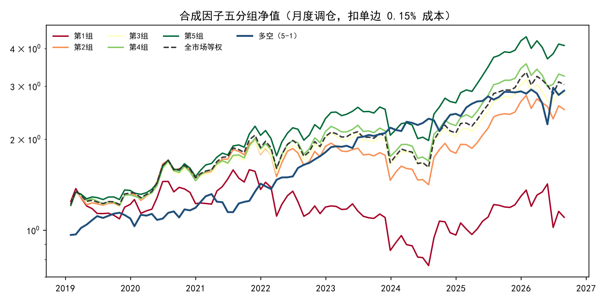
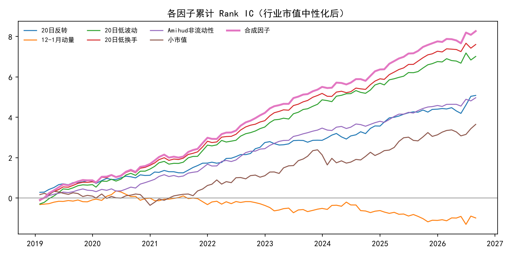

# A 股量价因子研究：IC 检验与分层回测

用 2018–2026 年沪深 A 股日频数据，检验反转、动量、波动率、换手率、非流动性、市值 6 个量价因子在月度截面上的预测能力，并评估一个事先固定权重的合成因子。

**公开数据学习项目，AI 辅助实现；回测结论是历史统计，不代表可实现收益。**

## 核心结论

- 行业与市值中性化后，**低换手**（Rank IC 0.083，年化 ICIR 2.61）与**低波动**（IC 0.076，年化 ICIR 2.08）预测能力最强；12-1 月动量 IC 为 −0.011、t 值 −0.88，在 A 股无显著效应。
- 事先固定的**合成因子**（反转、低波动、低换手、非流动性等权）月均 IC 0.090，年化 ICIR 2.66，92 期中 79% 的月份 IC 为正。
- 五分组单调：第 5 组扣费后年化 20.2%，第 1 组 1.3%。多空组合年化 14.9%、夏普 0.87、最大回撤 −23.3%；第 5 组相对全市场等权年化超额 3.7%，最大回撤 −8.5%。
- 结论在两个子区间、剔除小市值 30%、次日收盘成交三项检验下方向一致；但 2023 年后多空夏普从 1.23 降至 0.68，波动明显上升。



## 数据

| 项目 | 说明 |
|---|---|
| 行情 | 新浪财经日线（AKShare `stock_zh_a_daily`），后复权，2018-01-02 至 2026-09-30 |
| 股票池 | 沪深主板、创业板、科创板在市股票 5,220 只，919 万行；不含北交所 |
| 股票列表、行业 | baostock：上市日期、证监会行业分类（取大类，如 C39） |
| 流通市值 | 成交额 ÷ 换手率 的 20 日中位数，作为流通市值近似 |

## 方法

**调仓与样本**：每月最后一个交易日收盘计算因子、构建组合，持有至下月最后一个交易日，共 92 期（2019-01 至 2026-08），平均每期 4,213 只股票。剔除当日停牌、近 20 日有效交易不足 15 天、上市不满一年的股票。

**因子定义**（方向统一为“值越大预期收益越高”）

| 因子 | 定义 |
|---|---|
| 20 日反转 | −(过去 20 日收益) |
| 12-1 月动量 | t−250 至 t−20 日收益 |
| 20 日低波动 | −(20 日日收益标准差) |
| 20 日低换手 | −(20 日平均换手率) |
| Amihud 非流动性 | log(20 日平均 \|日收益\| / 成交额) |
| 小市值 | −log(流通市值) |

**预处理**：截面 MAD 去极值（中位数 ± 5 倍）、标准化，再对行业哑变量与对数市值回归取残差（市值因子只对行业中性化）。

**评价**：月度 Rank IC（Spearman）、ICIR、t 值、IC 衰减（滞后 1–6 月）；按合成因子分五组等权持有，按每期实际换手扣除单边 0.15% 交易成本。

**事先约定**：合成因子成分与等权方式、成本假设、调仓频率在运行回测前写入代码（见 `research.py` 文件头），未根据结果调整。

## 结果

### 单因子 IC（行业市值中性化后，92 期）

| 因子 | IC 均值 | 年化 ICIR | t 值 | IC>0 占比 |
|---|---:|---:|---:|---:|
| 20 日反转 | 0.055 | 1.77 | 4.91 | 68.5% |
| 12-1 月动量 | −0.011 | −0.32 | −0.88 | 50.0% |
| 20 日低波动 | 0.076 | 2.08 | 5.77 | 75.0% |
| 20 日低换手 | 0.083 | 2.61 | 7.22 | 76.1% |
| Amihud 非流动性 | 0.054 | 2.18 | 6.02 | 73.9% |
| 小市值 | 0.040 | 0.91 | 2.53 | 65.2% |
| **合成因子** | **0.090** | **2.66** | **7.36** | **79.3%** |



**IC 衰减**：反转因子衰减最快，滞后 2 个月 IC 降至 0.015，3 个月后接近 0，属于短周期信号；低换手、低波动在滞后 6 个月仍有 0.03 左右，信号更持久。合成因子从 0.090（1 月）降至 0.030（6 月）。完整数据见 `results/ic_decay.csv`。

### 合成因子五分组（扣费后）

| 组合 | 年化收益 | 年化波动 | 夏普 | 最大回撤 |
|---|---:|---:|---:|---:|
| 第 1 组（最低） | 1.3% | 28.1% | 0.19 | −51.9% |
| 第 3 组 | 14.5% | 21.4% | 0.74 | −23.0% |
| 第 5 组（最高） | 20.2% | 21.3% | 0.97 | −22.6% |
| 全市场等权 | 15.6% | 22.2% | 0.77 | −23.8% |
| 多空（5−1） | 14.9% | 17.7% | 0.87 | −23.3% |
| 第 5 组超额 | 3.7% | 5.8% | 0.65 | −8.5% |

第 5 组月均单边换手 44%，第 1 组 48%，中间组约 67–70%。

### 稳健性

| 检验 | 合成 IC | 年化 ICIR | 多空夏普 | 说明 |
|---|---:|---:|---:|---|
| 基准 | 0.090 | 2.66 | 0.87 | |
| 2019–2022 | 0.088 | — | 1.23 | 多空最大回撤 −12.9% |
| 2023–2026.08 | 0.092 | — | 0.68 | 多空最大回撤 −23.3%，波动上升 |
| 剔除流通市值最小 30% | 0.085 | 2.33 | 0.65 | 第 5 组超额降至 2.7% |
| 次一交易日收盘成交 | 0.090 | 2.63 | 0.90 | 排除同一收盘价算因子并成交的偏差 |
| 剔除持有期单日跳空 > 21% | 0.090 | 2.66 | 0.87 | 平均每期仅剔除约 0.01 只 |

剔除小市值后收益下降，说明部分超额来自小盘股，实际容量有限。

## 局限

- **幸存者偏差**：新浪不提供已退市股票行情，股票列表中 2019 年后退市的 238 只未纳入。全市场等权年化 15.6% 偏高与此有关；退市股多为低价、高换手、高波动股票，可能使低换手、低波动因子的效果被高估。
- **未剔除 ST**：行情源无历史 ST 标记。
- **行业为静态分类**：使用下载当日的证监会行业，未反映历史行业变更。
- **市值为近似值**：用成交额 / 换手率估算流通市值，未使用真实股本数据。
- **多空不可直接实现**：A 股融券受限，多空收益只用于衡量因子区分度；第 5 组超额更接近可实现的结果，但未考虑冲击成本与涨跌停无法成交。
- 交易成本为统一假设（单边 0.15%），未区分印花税调整前后。

## 复现

Python 3.12，在项目目录中运行：

```powershell
python -m venv .venv
.\.venv\Scripts\python -m pip install -r requirements.txt
.\.venv\Scripts\python fetch_data.py data      # 约 2.5 小时, 单进程限速, 请勿改为并发
.\.venv\Scripts\python research.py data        # 约 15 分钟
```

`fetch_data.py` 按 100 只一个分片落盘，中断后重跑会跳过已完成的分片。原始数据不随仓库发布（见 `.gitignore`）。

## 文件

| 文件 | 内容 |
|---|---|
| `fetch_data.py` | 股票列表、行业与日线下载 |
| `research.py` | 因子构建、中性化、IC、分组回测、稳健性检验 |
| `results/ic_summary.csv` | 单因子 IC 统计 |
| `results/ic_monthly.csv` | 逐月 IC |
| `results/ic_decay.csv` | IC 衰减 |
| `results/composite_group_perf.csv` | 合成因子分组绩效 |
| `results/composite_group_returns.csv` | 合成因子分组逐月收益 |
| `results/ic_summary_ex_small30.csv` | 剔除小市值后的 IC 统计 |
| `results/summary.json` | 分段、稳健性检验等汇总 |
