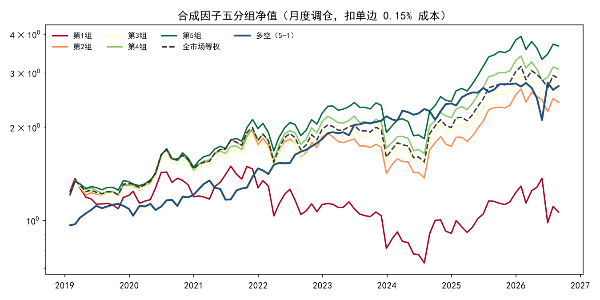
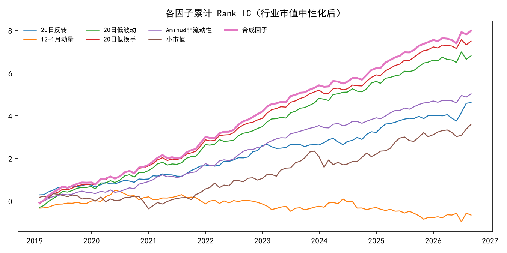

# A 股量价因子研究：IC 检验与分层回测

用 2018–2026 年沪深 A 股日频数据（含已退市股票），检验反转、动量、波动率、换手率、非流动性、市值 6 个量价因子在月度截面上的预测能力，并评估一个事先固定权重的合成因子。

研究约定（因子定义、合成权重、成本假设、调仓频率、股票池规则）在运行回测前写入代码，结论未经事后调参。

## 核心结论

- 行业与市值中性化后，**低换手**（Rank IC 0.082，年化 ICIR 2.55）与**低波动**（IC 0.074，年化 ICIR 2.01）预测能力最强；12-1 月动量 IC 为 −0.007、t 值 −0.57，在 A 股无显著效应。
- 事先固定的**合成因子**（反转、低波动、低换手、非流动性等权）月均 IC 0.087，年化 ICIR 2.56，92 期中 76% 的月份 IC 为正。
- 五分组单调：第 5 组扣费后年化 18.5%，第 1 组 0.8%。多空组合年化 14.0%、夏普 0.83、最大回撤 −24.1%；第 5 组相对全市场等权年化超额 3.0%，最大回撤 −9.0%。
- 股票池已**剔除 ST、剔除调仓日涨跌停、纳入退市股票**。三组对照实验显示：涨跌停处理影响最大（不处理时多空年化虚高 1.0 个百分点），幸存者偏差使全市场等权年化虚高 0.6 个百分点，ST 剔除几乎不改变结论（见[股票池处理的影响](#股票池处理的影响)）。
- 结论在两个子区间、剔除小市值 30%、次日收盘成交三项检验下方向一致；但 2023 年后多空夏普从 1.27 降至 0.59，2026 年前 8 个月多空为 −1.9%。
- 多空夏普远低于 ICIR 给人的印象：亏损集中在少数风格反转月份，剔除最差 3 个月后夏普为 1.18（见[分年度与尾部月份](#分年度与尾部月份为什么-icir-256-而多空夏普只有-083)）。



## 数据

| 项目 | 来源与说明 |
|---|---|
| 行情 | 新浪财经日线（AKShare `stock_zh_a_daily`），后复权，2018-01-02 至 2026-09-30 |
| 股票池 | 沪深主板、创业板、科创板 5,459 只，948 万行；其中 240 只为 2019 年后退市的股票；不含北交所 |
| 股票列表 | baostock：上市日期、退市日期 |
| 退市股换手率 | 新浪不提供退市股的换手率，从腾讯财经（`stock_zh_a_hist_tx`）补齐；腾讯的后复权价格与新浪不一致，只取换手率 |
| 行业 | 东方财富数据中心的证监会行业（门类-大类，83 个），覆盖全部股票，含退市股 |
| ST 历史 | 深市：深交所“简称变更”记录还原出带日期的 ST 区间；沪市：用 5% 涨跌幅限制推断（见下） |
| 股票简称 | 东方财富数据中心，下载当日（2026-11）的简称，只用于核对沪市 ST 的识别结果 |
| 流通市值 | 成交额 ÷ 换手率 的 20 日中位数，作为流通市值近似 |

列表中有 1 只（九号公司，存托凭证）新浪无行情，未纳入。

## 方法

**调仓与样本**：每月最后一个交易日收盘计算因子、构建组合，持有至下月最后一个交易日，共 92 期（2019-01 至 2026-08），平均每期 4,108 只股票。

**股票池规则**（每个调仓日）

| 规则 | 做法 | 平均每期剔除 |
|---|---|---:|
| 停牌、数据不足 | 当日无成交，或近 20 日有效交易不足 15 天 | — |
| 次新股 | 上市不满一年 | — |
| ST / *ST | 调仓日处于 ST 状态 | 152 只 |
| 涨跌停 | 成交日收盘价封在涨停或跌停价（涨停买不进、跌停卖不出） | 107 只 |
| 退市股 | 退市前照常进入样本，退市后按最后成交价计 | — |

涨跌停的判定：收盘价等于当日最高（最低）价，且涨跌幅达到限制。限制取主板 10%、科创板 20%、创业板 2020-08-24 起 20%；主板 ST 股票 2026-07-06 前为 5%，此后与主板一致为 10%；涨跌停价按分取整，低价股的实际涨跌幅会偏离名义限制，因此留有容差。

**沪市 ST 的推断与检验**：沪市没有找到带日期的公开 ST 记录，用价格行为推断——10 个交易日内两次收在 5% 涨跌停附近且期间没有超过 5.7% 的涨跌，视为进入 ST；出现超过 5.7% 的单日涨跌，视为退出。深市主板同时有交易所记录和价格数据，可以检验这个推断：2026-07-06 前的 90 期调仓日、6,502 个“股票 × 调仓日”的 ST 观测上，召回率 97.8%，精确率 95.2%。

2026-07-06 起主板 ST 股票的涨跌幅限制由 5% 调整为 10%，价格不再能区分 ST 与非 ST。此后沪市 ST 沿用规则变更前最后一个交易日（07-03）的状态。同样的做法在深市主板上检验：规则变更后的 2 期调仓日召回率 96.0%，精确率 88.4%。另用下载当日的股票简称核对样本期末状态：沪市主板 1,700 只在市股票中 1,687 只一致，8 只判为 ST 但简称已不含 ST，5 只简称含 ST 但未识别。

**因子定义**（方向统一为“值越大预期收益越高”）

| 因子 | 定义 |
|---|---|
| 20 日反转 | −(过去 20 日收益) |
| 12-1 月动量 | t−250 至 t−20 日收益 |
| 20 日低波动 | −(20 日日收益标准差) |
| 20 日低换手 | −(20 日平均换手率) |
| Amihud 非流动性 | log(20 日平均 \|日收益\| / 成交额) |
| 小市值 | −log(流通市值) |

**预处理**：截面 MAD 去极值（中位数 ± 5 倍）、标准化，再对行业哑变量与对数市值回归取残差（市值因子只对行业中性化）。

**评价**：月度 Rank IC（Spearman）、ICIR、t 值、IC 衰减（滞后 1–6 月）；按合成因子分五组等权持有，按每期换手扣除单边 0.15% 交易成本。换手计算考虑持仓漂移：上期持仓先按持有期收益变动权重，再与本期目标权重比较。

**事先约定**：合成因子成分与等权方式、成本假设、调仓频率、股票池规则在运行回测前写入代码（见 `research.py` 文件头），未根据结果调整。

## 结果

### 单因子 IC（行业市值中性化后，92 期）

| 因子 | IC 均值 | 年化 ICIR | t 值 | IC>0 占比 |
|---|---:|---:|---:|---:|
| 20 日反转 | 0.050 | 1.61 | 4.46 | 64.1% |
| 12-1 月动量 | −0.007 | −0.21 | −0.57 | 54.3% |
| 20 日低波动 | 0.074 | 2.01 | 5.57 | 76.1% |
| 20 日低换手 | 0.082 | 2.55 | 7.06 | 76.1% |
| Amihud 非流动性 | 0.055 | 2.18 | 6.03 | 71.7% |
| 小市值 | 0.039 | 0.88 | 2.44 | 65.2% |
| **合成因子** | **0.087** | **2.56** | **7.10** | **76.1%** |



**IC 衰减**：反转因子衰减最快，滞后 2 个月 IC 降至 0.011，3 个月后接近 0，属于短周期信号；低换手、低波动在滞后 6 个月仍有 0.03 左右，信号更持久。合成因子从 0.087（1 月）降至 0.028（6 月）。完整数据见 `results/ic_decay.csv`。

### 合成因子五分组（扣费后）

| 组合 | 年化收益 | 年化波动 | 夏普 | 最大回撤 |
|---|---:|---:|---:|---:|
| 第 1 组（最低） | 0.8% | 27.9% | 0.17 | −51.4% |
| 第 3 组 | 13.6% | 21.3% | 0.71 | −23.4% |
| 第 5 组（最高） | 18.5% | 21.6% | 0.89 | −23.6% |
| 全市场等权 | 14.8% | 22.2% | 0.73 | −24.1% |
| 多空（5−1） | 14.0% | 17.6% | 0.83 | −24.1% |
| 第 5 组超额 | 3.0% | 5.8% | 0.53 | −9.0% |

第 5 组月均单边换手 47%，第 1 组 53%，中间组约 69–71%。

### 股票池处理的影响

每次只放松一项处理，其余与基准相同：

| 设定 | 平均每期股票数 | 合成 IC | 年化 ICIR | 全市场等权年化 | 多空年化 | 多空夏普 | 第 5 组超额 |
|---|---:|---:|---:|---:|---:|---:|---:|
| **基准**（三项都处理） | 4,108 | 0.087 | 2.56 | 14.8% | 14.0% | 0.83 | 3.0% |
| 不剔除 ST | 4,237 | 0.086 | 2.59 | 15.0% | 13.9% | 0.84 | 3.0% |
| 不剔除涨跌停 | 4,188 | 0.090 | 2.62 | 14.4% | 15.0% | 0.86 | 3.3% |
| 仅在市股票（不含退市股） | 4,026 | 0.086 | 2.54 | 15.4% | 13.5% | 0.81 | 3.0% |

- **涨跌停影响最大**：假设涨跌停股票也能按收盘价成交，多空年化从 14.0% 虚高到 15.0%，第 5 组超额从 3.0% 虚高到 3.3%。
- **幸存者偏差主要抬高市场基准**：去掉退市股后全市场等权年化从 14.8% 升到 15.4%；因子的 IC 和多空几乎不变，没有出现“退市股让低换手、低波动因子显得更好”的情况。
- **ST 剔除几乎不改变结论**：IC、多空、超额的变化都在 0.1 个百分点左右。

### 稳健性

| 检验 | 合成 IC | 年化 ICIR | 多空夏普 | 说明 |
|---|---:|---:|---:|---|
| 基准 | 0.087 | 2.56 | 0.83 | |
| 2019–2022 | 0.087 | — | 1.27 | 多空最大回撤 −13.3% |
| 2023–2026.08 | 0.086 | — | 0.59 | 多空最大回撤 −24.1%，年化波动从 12.6% 升至 21.9% |
| 剔除流通市值最小 30% | 0.084 | 2.34 | 0.67 | 第 5 组超额降至 2.6% |
| 次一交易日收盘成交 | 0.090 | 2.61 | 0.88 | 排除同一收盘价算因子并成交的偏差 |
| 剔除持有期单日跳空 > 21% | 0.087 | 2.56 | 0.83 | 结果与基准几乎相同 |

剔除小市值后收益下降，说明部分超额来自小盘股，实际容量有限。

### 分年度与尾部月份：为什么 ICIR 2.56 而多空夏普只有 0.83

| 年份 | 第 1 组 | 第 5 组 | 全市场等权 | 多空 | 第 5 组超额 | 月均 IC |
|---|---:|---:|---:|---:|---:|---:|
| 2019 | 20.7% | 33.5% | 31.6% | 9.0% | 1.1% | 0.072 |
| 2020 | −1.1% | 11.4% | 11.8% | 11.1% | −0.3% | 0.069 |
| 2021 | 6.9% | 33.4% | 23.6% | 21.7% | 7.8% | 0.109 |
| 2022 | −11.6% | 12.3% | 8.6% | 24.4% | 2.9% | 0.100 |
| 2023 | −27.9% | −13.4% | −18.8% | 18.5% | 6.6% | 0.102 |
| 2024 | 11.9% | 25.8% | 24.7% | 10.0% | 0.7% | 0.067 |
| 2025 | 35.4% | 58.2% | 51.6% | 16.1% | 4.4% | 0.110 |
| 2026（至 8 月） | −13.5% | −4.3% | −4.9% | −1.9% | −0.1% | 0.055 |

多空在 2019–2025 年每年为正，2026 年前 8 个月为 −1.9%；第 5 组超额在 2020 年和 2026 年略为负。

IC 衡量的是约 4,100 只股票的排序相关，每月都有大量股票参与平均，所以很稳定；多空收益只看首尾两组的收益差，波动由少数月份决定：

| 持有期起点 | 当月 IC | 第 1 组 | 第 5 组 | 多空 |
|---|---:|---:|---:|---:|
| 2026-05-29 | −0.151 | 7.0% | −8.0% | −15.0% |
| 2021-06-30 | −0.055 | 6.0% | −1.6% | −7.7% |
| 2026-04-30 | −0.072 | 2.6% | −4.8% | −7.4% |

- 最差的 6 个月 IC 全部为负，都是第 1 组（高换手、高波动、近期涨幅大的股票）跑赢第 5 组的风格反转月份。
- 第 1 组年化波动 27.9%，高于第 5 组的 21.6%，多空组合的波动主要来自空头一侧。
- 剔除最差 3 个月后多空夏普从 0.83 升至 1.18。这个数字只用于说明亏损的集中程度，不是可以实现的收益。

数据由 `diagnose.py` 从 `results/` 中的逐月收益生成。

## 局限

- **沪市 ST 为推断值**：2026-07-06 前在深市主板上检验召回率 97.8%、精确率 95.2%；规则变更后只能沿用变更前的状态，期间新增或撤销的 ST 识别不到（精确率降至 88.4%）。科创板的 ST 无法识别（20% 涨跌幅限制下没有可用的价格特征）。
- **涨跌停处理是简化的**：只剔除成交日收盘封板的股票，没有区分“涨停买不进”与“跌停卖不出”的方向，也没有处理已持仓股票跌停时卖不出、被动延后的情况。
- **退市收益是近似的**：退市后按最后成交价计，没有计入退市整理期之后进入三板的进一步损失。
- **行业为静态分类**：使用下载当日的证监会行业，未反映历史行业变更。
- **市值为近似值**：用成交额 / 换手率估算流通市值，未使用真实股本数据。
- **多空不可直接实现**：A 股融券受限，多空收益只用于衡量因子区分度；第 5 组超额更接近可实现的结果，但未考虑冲击成本。
- 交易成本为统一假设（单边 0.15%），未区分印花税调整前后。
- 数据来自免费行情接口，未与商业数据库逐项核对。

## 复现

Python 3.14，在项目目录中运行：

```powershell
python -m venv .venv
.\.venv\Scripts\python -m pip install -r requirements.txt
.\.venv\Scripts\python fetch_data.py data            # 约 3–5 小时, 单进程限速, 请勿改为并发
.\.venv\Scripts\python fetch_data.py data --merge    # 合并分片
.\.venv\Scripts\python fetch_meta.py data            # 行业与深市 ST 历史, 约 1 分钟
.\.venv\Scripts\python research.py data              # 约 15 分钟
.\.venv\Scripts\python diagnose.py                   # 分年度与尾部月份, 只读 results/
```

`fetch_data.py` 按 100 只一个分片落盘，中断后重跑会跳过已完成的分片。原始数据不随仓库发布（见 `.gitignore`）。免费接口的数据会随复权基准更新而变化，重新下载后的结果可能与本文有小幅出入。

## 文件

| 文件 | 内容 |
|---|---|
| `fetch_data.py` | 股票列表（含退市股）与日线下载 |
| `fetch_meta.py` | 行业分类与深市 ST 历史区间下载 |
| `research.py` | 因子构建、股票池规则、中性化、IC、分组回测、稳健性与对照实验 |
| `diagnose.py` | 分年度表现与多空尾部月份诊断 |
| `results/ic_summary.csv` | 单因子 IC 统计 |
| `results/ic_monthly.csv` | 逐月 IC |
| `results/ic_decay.csv` | IC 衰减 |
| `results/composite_group_perf.csv` | 合成因子分组绩效 |
| `results/composite_group_returns.csv` | 合成因子分组逐月收益 |
| `results/ic_summary_ex_small30.csv` | 剔除小市值后的 IC 统计 |
| `results/summary.json` | 分段、稳健性、对照实验、ST 推断检验等汇总 |
| `results/composite_yearly.csv` | 合成因子分年度收益与 IC |
| `results/long_short_worst_months.csv` | 多空最差 6 个月的分组收益 |

<sub>使用 AI 编程工具辅助开发，研究方向、结果核验与结论由本人负责。回测结果为历史统计，不构成投资建议。</sub>
